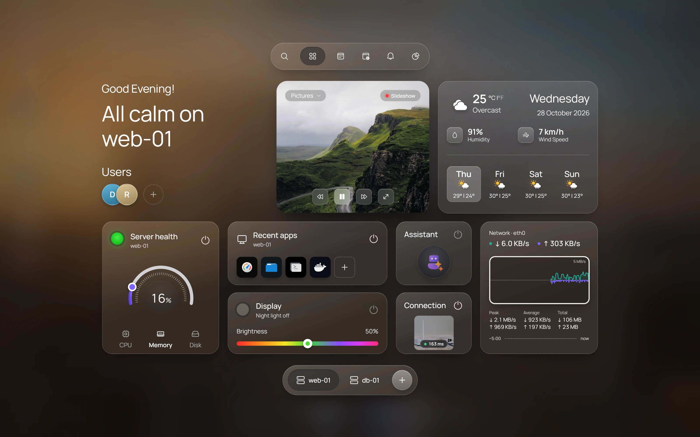
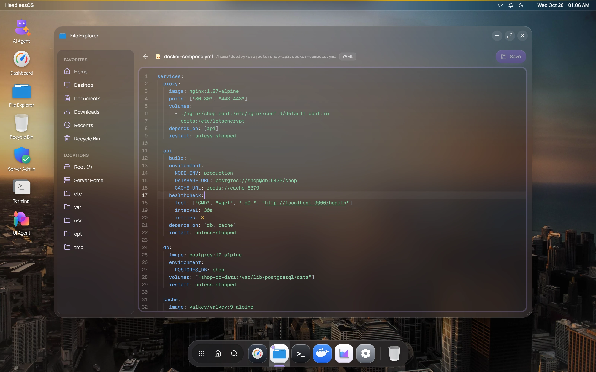
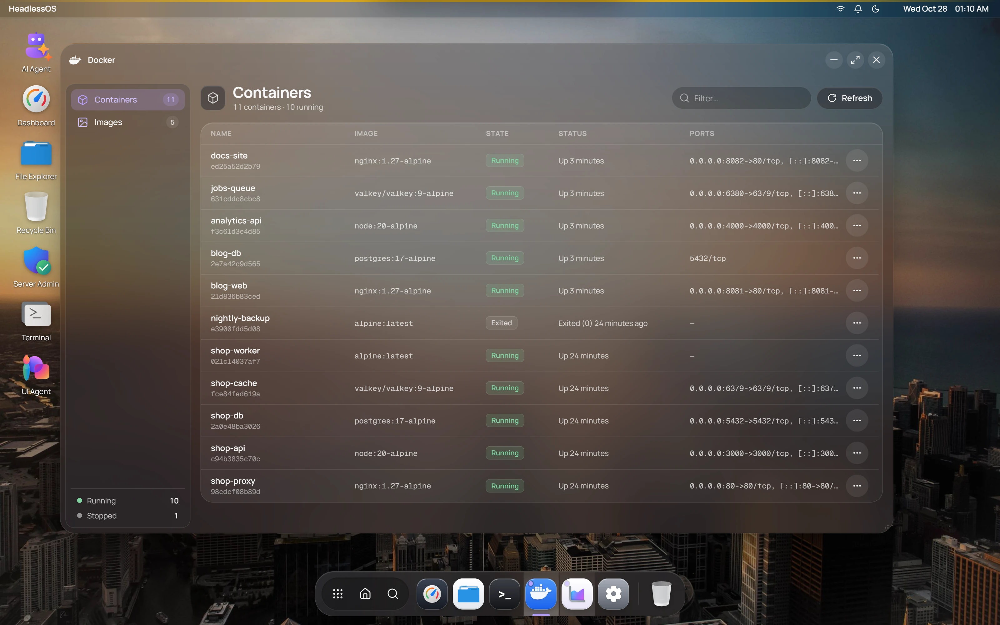

HeadlessOS 0.2.0 is out. It's the biggest update since the first release: a redesigned desktop, Claude and local models next to OpenAI, AI agents that can't run arbitrary commands, and files and shells inside Docker containers. It's also the first release under the MIT licence.

If you're new here: HeadlessOS turns your Linux servers into a desktop you can use with a mouse. It runs on your computer, connects over SSH and installs nothing on the server. [Download it for Windows or macOS](/download).



## A new desktop

The whole interface has been redesigned around a glass desktop with a dock, an app launcher, Quick Settings and notifications.

- **The Home hub** is a start page for each server: its health, your recent apps, and live network traffic for the last 1, 5 or 15 minutes, with peak, average and total.
- **The Fleet overview** shows every server on one screen. Each card has a status light and dials for CPU, memory and disk, and a summary covers the whole fleet.
- **File Explorer** has a code editor, so you can fix a config file without leaving the window. Home, Desktop, Documents and Downloads now follow the signed-in user's home folder on each server.
- **Task Manager** adds app history, startup apps, users and services.
- **The dock** marks every open app, and highlights the one in front, so a minimized app no longer looks closed.



## Choose your model: OpenAI, Claude or a local one

AI in HeadlessOS is optional, and every app works without it. If you want it, Settings → AI now offers three providers:

- **Claude:** Haiku 5.5, Sonnet 5.5 or Opus 5.5. Your key is checked with Anthropic before it's saved, and it's stored encrypted.
- **Local models through Ollama:** pick any model you've installed. HeadlessOS reads the model's real context window and sizes every request to fit it. With a local model, your server's data stays on hardware you control.
- **OpenAI**, as before.

## Agents you can trust with a server

This release rebuilds how the AI agents touch your servers:

- **No free-form commands.** Agents call typed actions from a fixed catalog. HeadlessOS checks the parameters, builds the command itself and quotes it safely.
- **You approve every change.** Anything that would change a server waits for your OK, and it's written to an audit log.
- **Secrets stay out of prompts.** Secrets are removed from server output before a model sees it.
- **Small models stay on track.** Long runs are compacted in layers, loops are caught and stopped, and broken or cut-off replies are asked for again.

## The UI Agent builds views you can check

Ask the UI Agent something like "which containers use the most memory?", and it builds a view widget by widget while it works. The values in that view are filled from what your server returned, not typed out by the model, so the numbers come from your server.

Follow-up requests, such as "only the stopped ones", refine the open view in the same window. If a request is unclear, the agent asks you a question instead of guessing.

## Files and shells inside Docker containers

The Docker app can now browse, edit, upload and delete files inside a container, and open a shell in it, all over the same SSH connection. There's no `docker cp` or `docker exec -it` to remember.



## Security work before open source

Before publishing the code, we audited it:

- Two command-injection paths were closed.
- Every API and WebSocket call needs a token created for your install, and Host and WebSocket-origin headers are checked, so other websites open in your browser can't talk to HeadlessOS.
- Each install has its own secret for encrypting saved passwords.
- Production dependencies have no known high or critical advisories.

The project is now MIT-licensed, and its [security policy](https://github.com/abhee235/headlessos/blob/main/SECURITY.md) explains how to report a vulnerability.

## Fixes worth knowing about

- **The 0.1.0 desktop app couldn't reach its own backend**, so it couldn't load or connect to your servers. If you tried 0.1.0 and gave up, please try again: 0.2.0 fixes this. The desktop app also has its wallpapers now.
- If the backend is restarting, the sign-in screen says so and retries every few seconds, instead of claiming you have no servers.
- Local models no longer show a made-up cost.

## Download and first launch

| Platform | File |
|---|---|
| Windows | `HeadlessOS.Setup.0.2.0.exe` (installer) or `HeadlessOS.0.2.0.exe` (portable) |
| macOS, Apple silicon and Intel | `HeadlessOS-0.2.0-universal.dmg` |
| Linux | Run from source with the [Quick Start](/docs/getting-started) |

Get them from the [download page](/download). The builds aren't code-signed, so your system warns you on the first launch:

- **Windows:** if SmartScreen says "Windows protected your PC", click **More info**, then **Run anyway**.
- **macOS:** open the app once, then go to **System Settings → Privacy & Security** and click **Open Anyway**. If macOS says the app "is damaged", run this in Terminal and open the app again:

```bash
xattr -cr /Applications/HeadlessOS.app
```

## What's next

Tell us what you need. Open an [issue on GitHub](https://github.com/abhee235/headlessos/issues) for a bug or a feature request. The [changelog](https://github.com/abhee235/headlessos/blob/main/CHANGELOG.md) lists every change in this release.

Wondering how HeadlessOS compares with the tools you already know? Read [Cockpit vs Webmin vs HeadlessOS](/blog/cockpit-vs-webmin-vs-headlessos).
