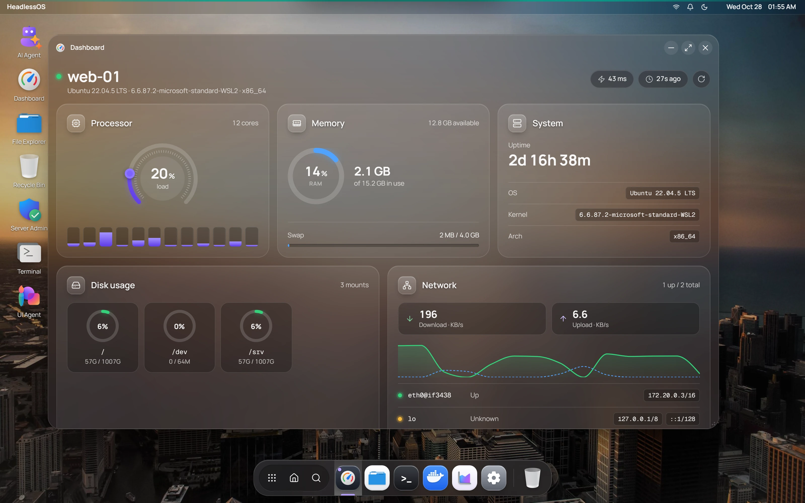

The Dashboard shows the health of one server in a single window. It needs no extra tools on the server. It reads standard commands such as `df -h`, `free -m` and `ip -brief addr` over SSH.

To open it, click **Dashboard** in the dock or double-click its desktop icon.

## What the Dashboard shows

The header shows the server's hostname, operating system, kernel and architecture. Next to them are the latency of the last refresh, the time since that refresh, and a **Refresh** button.

| Card | What it shows |
|---|---|
| **Processor** | Overall load, the number of cores, and a tile for each core. Hover a tile to see that core's load. |
| **Memory** | RAM in use, the amount available, and swap use. |
| **System** | Uptime, OS, kernel and architecture. |
| **Disk usage** | A ring for each mounted filesystem, with percent used, mount point, and used and total size. |
| **Network** | Download and upload rates, a graph of recent traffic, and each network interface with its state and addresses. |

A disk ring turns amber at 70% and red at 90%. The download and upload rates add up all interfaces.

## How often the Dashboard refreshes

| Data | How often it refreshes |
|---|---|
| Processor and network rates | Every 2 seconds |
| Memory, disks and system details | Every 30 seconds by default |

To change the second interval, open [Settings](/docs/guides/settings), go to **General** and set **Auto-Refresh Interval**. Choose **Off** to update those cards only when you click **Refresh**.

Updates stop while the window is minimized. They start again when you restore it.

## If the connection drops

If the SSH connection is lost, the Dashboard says so and shows a **Reconnect** button.

## Related apps

- To see which process is using the CPU or memory, open [Task Manager](/docs/apps/task-manager).
- To compare all your servers, use the [Fleet overview](/docs/guides/sessions-and-fleet).
