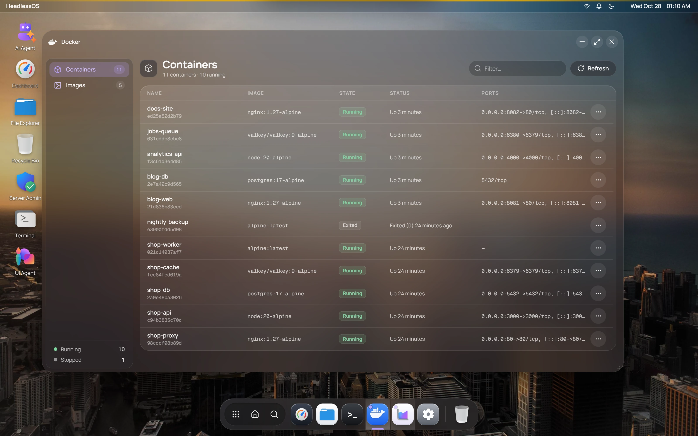

The Docker app runs the `docker` command on your server over SSH and shows the results. You don't need Docker Desktop or an agent on the server.



## What you need on the server

You need Docker Engine and an SSH user that can run `docker` without `sudo`. That means root, or a member of the `docker` group:

```bash
sudo usermod -aG docker pi
```

Disconnect and connect again so the change takes effect.

If Docker isn't installed, the app shows **Docker is not installed** with an **Install Docker** button. Click it, then click **Start Installation** to run the official script from get.docker.com in a terminal. This needs `sudo` on the server, and you may be asked for your password there.

## Manage containers

**Containers** lists each container's name, image, state, status and ports. Use **Filter…** to narrow the list. It refreshes with your **Auto-Refresh Interval**, at most every 5 seconds.

Right-click a row, or click its **...** button:

| Container state | Actions |
|---|---|
| Running | Stop, Restart, Pause, View Logs, Open Files, Open Shell, Force Remove |
| Paused | Unpause, View Logs, Remove |
| Exited or dead | Start, View Logs, Remove |

**View Logs** opens a panel with the last 500 lines, updated every 3 seconds.

## Open a shell in a container

Choose **Open Shell** on a running container. A window opens with `bash` if the container has it, otherwise `sh`. Type `exit` to end the session.

## Browse files inside a container

Choose **Open Files** on a running container. Double-click a folder to open it, or use **Up** and the path bar.

This works through `docker exec`, so the container needs commands such as `ls` and `base64`. Very small images may not have them.

## Edit a file inside a Docker container

Double-click a file, or right-click it and choose **Edit**. Press Ctrl+S or click **Save**. Files up to 2 MB open in the editor. Saving is limited to about 1 MB.

:::caution
Your edits are inside the container. They are lost when the container is removed, unless the file is on a volume.
:::

## Upload, download and delete container files

- **Upload** sends one file to the current folder, up to about 750 KB.
- **New File** and **New Folder** create items in the current folder.
- Right-click an item for **Download**, **Rename** and **Delete**.

**Delete** is permanent. Containers have no Recycle Bin.

## Manage images

**Images** lists each image's repository, tag, ID, size and creation date. Right-click a row for **Run Image**, **Remove Image** and **Force Remove**. To add an image, run `docker pull` in [Terminal](/docs/apps/terminal).

**Run Image** creates and starts a new container. Every field is optional:

| Field | Example |
|---|---|
| **Container Name** | `my-container` |
| **Port Mappings** | `8080:80, 3306:3306` |
| **Environment Variables** | `KEY=value, FOO=bar` |
| **Volume Mounts** | `/host/path:/container/path` |
| **Command Override** | Replaces the image's default command |
