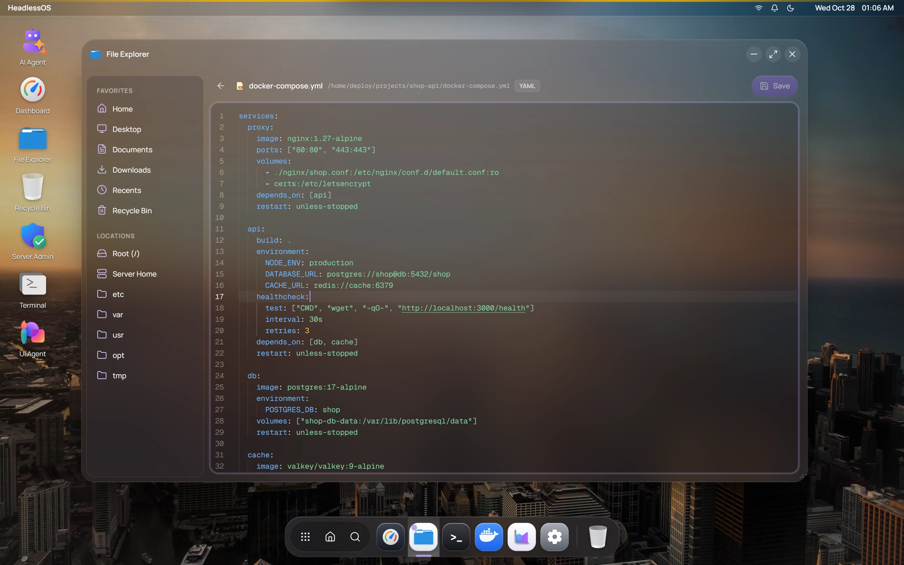

File Explorer works with files on your server through SFTP, the file transfer part of SSH. It needs no extra tools on the server. Copy, search and **Empty Recycle Bin** run `cp`, `find` and `rm` over SSH. The command palette lists the app as **Files**.

## Move around your server

The left pane has two groups:

- **Favorites** follow the user you signed in as. **Home** opens your own home folder, as the server reports it. **Desktop**, **Documents** and **Downloads** appear only if those folders exist there. **Recents** opens `/tmp`. It isn't a list of recent files.
- **Locations** are fixed: **Root (/)**, **Server Home** (`/home`), **etc**, **var**, **usr**, **opt** and **tmp**.

Use **Back**, **Forward** and **Up** next to the address bar, or click the path and type a new one.

The toolbar switches between **Large icons**, **Medium icons**, **List** and **Details**. To sort, right-click an empty area and choose **Sort by**. **Split pane view** shows two folders side by side.

## Edit a file on your server

Double-click a file to open it in the code editor, which colours the syntax for that file type. A **modified** badge appears when you have unsaved changes. Press Ctrl+S or click **Save**. The arrow at the top left returns to the file list.

Files up to 2 MB open in the editor. Saving is limited to about 1 MB. Files open as UTF-8 text.

## Upload files

Drag files from your computer onto the file list. They go into the folder you're viewing. Each file can be up to 20 MB. A card shows progress, and the result appears in your notifications.

## Copy, move, rename and delete files

Right-click a file or folder for **Open**, **Cut**, **Copy**, **Rename**, **Move to Trash**, **Delete Permanently** and **Properties**. **Properties** shows size, dates, permissions and owner. You can't change them there.

Right-click an empty area for **New Folder**, **New File** and **Paste**. To copy or cut several items, select them with Ctrl-click or Shift-click first. The clipboard belongs to the session, so you can't paste onto another server.

Click in the file list, then use these keys. On a Mac, use Cmd in place of Ctrl.

| Keys | Action |
|---|---|
| Ctrl+C, Ctrl+X, Ctrl+V | Copy, cut, paste |
| Ctrl+A | Select all |
| Delete | Move to Trash |
| Shift+Delete | Delete permanently |
| F2 | Rename |
| F5 | Refresh |
| Enter | Open |
| Escape | Clear the selection |

## Search for files

Press Ctrl+F or click **Search files**. Search checks file and folder names in the current folder and up to five levels below it. Type at least two characters. You can use wildcards such as `*.log`. Hidden files are skipped, and results stop at 200.

## Restore a file from the Recycle Bin

**Move to Trash** moves an item to `/tmp/.headlessos-trash` on the server. Open **Recycle Bin** from Favorites, the dock or the desktop. Right-click an item for **Restore** or **Delete Permanently**, or click **Empty Recycle Bin**.

:::caution
The Recycle Bin is in `/tmp`, so the server may clear it, for example when it reboots. **Restore** puts the item in `/tmp`, not back in its original folder.

If `/tmp` is on a different disk from the file, **Move to Trash** can fail. Use **Delete Permanently** instead.
:::
