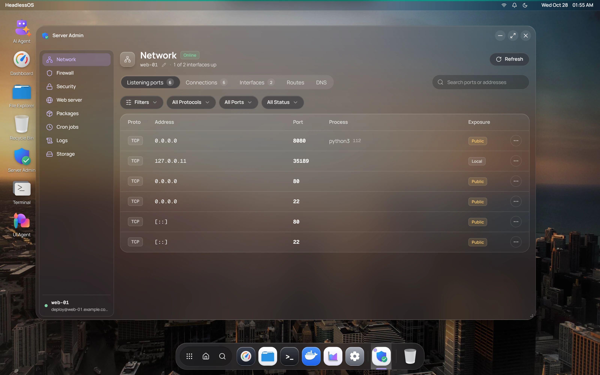

Server Admin puts common admin jobs in one window, with eight sections in the sidebar. The app itself has no required tools, but some sections work with one specific tool. If that tool is missing, the section says so.

:::caution
Most changes here run with `sudo`. Your SSH user must be root or able to run `sudo` without a password, because there's nowhere to type one. Without that, **Firewall** and **Fail2ban** can report that they aren't installed.
:::

## Check ports, connections and DNS

**Network** has five tabs:

- **Listening ports** shows the address, port, process and exposure. Use the search box to filter.
- **Connections** lists active connections.
- **Interfaces** shows each interface. **Disable** or **Enable** turns it off or on. Disabling your main interface can disconnect you.
- **Routes** lists the routing table.
- **DNS** shows nameservers and search domains. **Edit DNS** rewrites `/etc/resolv.conf`.

To change the hostname, click the pencil next to it.

## Manage firewall rules with UFW

**Firewall** uses UFW, so the server needs `ufw`. **Enable** or **Disable** turns it on or off.

- **Basic rule** allows or denies a port.
- **Advanced rule** targets a source IP or range, with an optional port range and comment.
- **App profiles** allows or denies a predefined profile, such as "Nginx Full".

## Manage users and SSH access

**Security** has five tabs:

- **Active sessions**: see who is logged in and kill a session.
- **Users**: **Add user**, **Set Password**, **Add to Group** and **Delete User**. Deleting also removes the home folder.
- **SSH config**: read the key SSH settings. You can't edit them here.
- **Login history**: recent logins.
- **Fail2ban**: click a jail to see its counts, then ban or unban IP addresses. **Reload Config** reloads Fail2ban.

## Manage nginx sites

**Web server** works with nginx. **Test** checks the configuration, and **Reload** and **Restart** act on nginx. Each site has **Config** to view its file, and **Enable** or **Disable**. The certificates list comes from `certbot`.

## Update packages with apt

**Packages** uses `apt`, so it works on Debian and Ubuntu.

- **Update lists** refreshes the package lists.
- **Upgradable** offers **Upgrade** for one package and **Upgrade All**.
- **Search & install** finds packages to install or remove.

## Schedule cron jobs

**Cron jobs** manages your user's crontab. Click **Add job**, pick a **Schedule Preset** or type a cron expression, then enter the command. You can edit or delete jobs in **User crontab**. **System crontab** is read-only.

## Search system logs

**Logs** reads `journalctl`, `dmesg` or `syslog`. Choose a source and up to 1,000 lines, then search.

**Advanced Filters** narrows by unit, priority and date. The buttons at the top turn on auto-refresh every 5 seconds and auto-scroll. **Export** saves the logs as a text file.

## Check storage and swap

**Storage** is read-only:

- **Mount points** lists mounted filesystems.
- **Directory sizes** covers `/var/log`, `/tmp`, `/home`, `/var/lib/docker` and `/var/cache`.
- **Swap** lists swap space.
