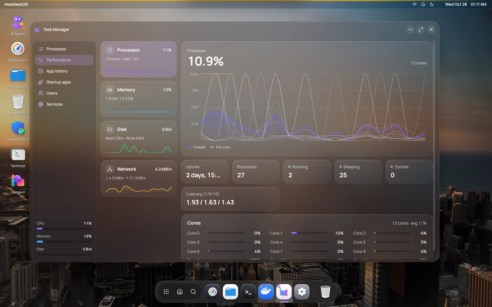

Task Manager shows what is running on your server and lets you stop it. It needs no extra tools on the server. It reads `ps`, `top`, `free` and files under `/proc` over SSH. **Processes** and **Performance** update every 2 seconds.

Open it from the dock, or right-click the desktop and choose **Task Manager**. Meters for CPU, memory and disk stay at the bottom of the sidebar on every page.

## Find and stop a process

Open **Processes**. Search with **Search processes, users or PIDs**, or filter with **All**, **Running**, **Idle** and **My processes**. Click a column heading to sort.

Click a process for a details card with its full command and CPU use over the last 60 seconds. The card has **Suspend**, which pauses the process, and **End task**.

Right-click a process for:

- **End Task**, which asks it to stop (SIGTERM).
- **Force Kill (SIGKILL)**, which stops it at once.
- **Copy PID** and **Copy Command**.

These run `kill` as your SSH user, without `sudo`. Unless you're root, you can only stop your own processes.

## Check CPU, memory, disk and network use

Open **Performance** and pick **Processor**, **Memory**, **Disk** or **Network** on the left for a live chart of recent readings.

| Panel | Details |
|---|---|
| **Processor** | Uptime, process counts, load average, and each core |
| **Memory** | Total, used, available, free and swap |
| **Disk** | Read and write rates, per device |
| **Network** | Receive and send rates, per interface |

## See resource use by app

Linux keeps no record of programs that have exited. **App history** shows totals for the programs running now, grouped by command: CPU time, memory, disk and the number running. Reading other users' disk figures needs root.

## Turn startup apps on or off

**Startup apps** lists services that start at boot, plus `@reboot` lines in cron. It shows each item's **Source**, and where available its **Impact** and **Delay** at boot. Those two need `systemd-analyze`.

Use the switch to enable or disable an item. HeadlessOS asks first and then runs `sudo systemctl`, or `update-rc.d` on servers without systemd. Disabling a service doesn't stop it now. It just won't start at the next boot.

You can't switch `@reboot` lines here. Change them in [Server Admin](/docs/apps/server-admin) under **Cron jobs**.

## See who is using the server

On the **Users** page, each account with running processes or a login session gets a card. It shows CPU, memory, the process count and where the account is logged in. A badge marks it **Active**, **Idle** or **Service**.

## Start or stop a service

The **Services** page lists services with their PID, status and startup type. Filter with **All**, **Running** and **Stopped**, or search by name.

**Start** and **Stop** ask you to confirm, then run with `sudo`. Stopping `ssh` shows an extra warning, because it can cut your connection. This page also works on servers without systemd. For more controls, use the [Services](/docs/apps/services) app.

:::note
Actions that use `sudo` need root or passwordless `sudo`, because there's nowhere to type a password.
:::
