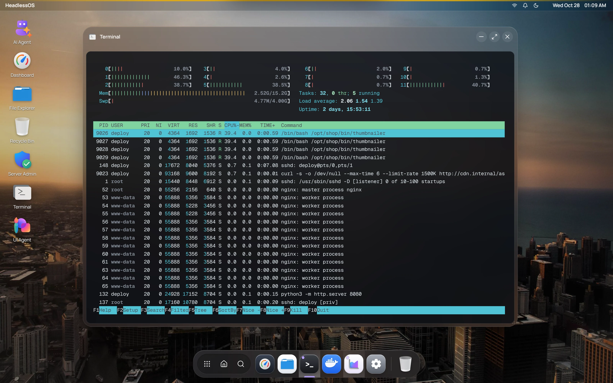

Terminal opens a real shell on your server over SSH. It needs no extra tools on the server. Colours, cursor movement and full-screen programs such as `vim`, `htop` and `tmux` work as they do in any SSH client.



Click **Terminal** in the dock, double-click its desktop icon, or use the launcher. Each server has one Terminal window. Opening the app again brings that window forward. When you resize the window, the shell resizes with it.

## Copy and paste in the terminal

Right-click in the terminal for **Copy**, **Paste**, **Select All** and **Clear**.

To copy text as soon as you select it, turn on **Copy on Select** in Settings.

Ctrl+C goes to the shell, so it stops the running program. Desktop shortcuts such as Ctrl+D are ignored while the terminal has focus, so they reach your shell too.

## Change the font, cursor and scrollback

Open [Settings](/docs/guides/settings) and go to **Terminal**. Changes apply to open terminals straight away.

| Setting | Options |
|---|---|
| **Font Size** | 10 to 24 |
| **Font Family** | Geist Mono, JetBrains Mono, Fira Code, Source Code Pro, Cascadia Code, Menlo, Courier New |
| **Cursor Style** | Block, Underline, Bar |
| **Scrollback Buffer** | 1,000, 5,000 or 10,000 lines, or Unlimited |
| **Copy on Select** | On or off |

## Keep a command running

:::caution
The shell ends when you close or minimize the Terminal window, or switch to another session. A new shell starts when the window comes back. Programs running in the old shell usually stop with it.
:::

To keep work running on the server, start it inside `tmux`:

```bash
tmux new -s work      # start a named session
tmux attach -t work   # come back to it later
```

`tmux` runs on the server. If it isn't installed, you can add it from [Server Admin](/docs/apps/server-admin) under **Packages**.

## Reconnect a terminal

If the connection drops, a **Disconnected** or **Connection error** banner appears. Click **Reconnect** to start a new shell.

## Open a shell inside a Docker container

In the [Docker](/docs/apps/docker) app, right-click a running container and choose **Open Shell**. It opens in its own terminal window.
