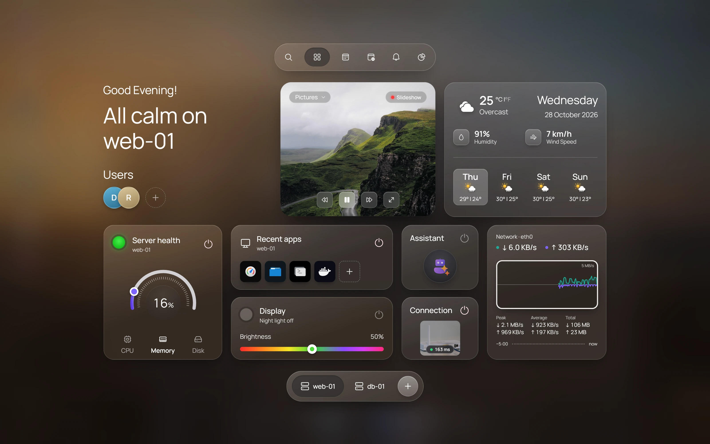

This guide takes you from download to a connected server. You need a Linux server you can reach over SSH, plus its username and a password or SSH key.

## 1. Download the app

Go to the [download page](/download) and pick the file for Windows, macOS or Linux.

The builds are unsigned, so your system may stop you the first time:

- **Windows:** in SmartScreen, choose **More info**, then **Run anyway**.
- **macOS:** open the app once, then go to **System Settings → Privacy & Security** and choose **Open Anyway**.
- **Linux:** run `chmod +x` on the AppImage, or install the `.deb`.

[Installation](/docs/installation) has the details for each system.

## 2. Open the sign-in screen

The app starts on a lock screen with a clock. Click or press any key. You land in the HeadlessOS Control Center, on the **Sessions** tab.

## 3. Add your server

1. Click **Add Server**.
2. Fill in the fields. **Port** starts at `22` and **Username** starts at `root`, so change them if your server is different.

   | Field | Example |
   | --- | --- |
   | Display Name | Home Pi |
   | Host | 192.168.1.20 |
   | Port | 22 |
   | Username | pi |

3. Under **Authentication**, choose **Password**, **SSH Key** or **Agent**, and fill in what it asks for.
4. Click **Add Server**.

This saves the server. It doesn't test the connection yet. [Connect a server](/docs/connect-a-server) explains each option.

## 4. Sign in

1. Click your server's tile.
2. If you saved a password in the form, leave the **Password** field empty. Otherwise, type it. With an SSH key, type the passphrase only if the key has one and you didn't save it.
3. Press Enter, or click the arrow. With **Agent**, click **Sign in**.

The desktop opens. If you see an error instead, go to [Troubleshooting](/docs/troubleshooting).

## 5. Look around

The dock at the bottom starts with three buttons:

- **Launcher** lists your apps.
- **Home hub** shows a summary of the selected server.
- **Search** opens the command palette. You can also press Ctrl+K.

After those come your pinned apps: Dashboard, File Explorer, Terminal, Docker, Task Manager and Settings. Click **Dashboard** to see CPU, memory, disk and network.



[The desktop](/docs/guides/desktop) covers windows, shortcuts and the rest.

## 6. Turn on AI (optional)

Everything above works with no AI. To use the AI Agent or the UI Agent, open **Settings → AI / LLM** and choose a provider. See [Set up AI](/docs/ai/setup).

## Run from source instead

To run HeadlessOS in your browser, or to change the code, you need Git, Node.js 20 or later and npm 9 or later.

```bash
git clone https://github.com/abhee235/headlessos.git
cd headlessos
npm install
cp .env.example .env
npm run dev
```

Open [http://localhost:3000](http://localhost:3000), then follow steps 2 to 5 above. [Installation](/docs/installation#run-from-source) has more on this route.

## Try it without a server

The repository includes a test SSH server, an Ubuntu container. With Docker running, start it from the repository folder:

```bash
cd dev && docker compose up -d
```

Then add a server with these values:

| Field | Value |
| --- | --- |
| Host | 127.0.0.1 |
| Port | 2222 |
| Username | testuser |
| Password | testpass |

The password is public, so stop the container when you finish, with `docker compose down`.

## Next steps

- [Connect a server](/docs/connect-a-server): SSH keys, agents and what each app needs.
- [Dashboard](/docs/apps/dashboard): what each panel shows.
- [Sessions and Fleet](/docs/guides/sessions-and-fleet): work with several servers.
- [Troubleshooting](/docs/troubleshooting): fix a failed connection.
