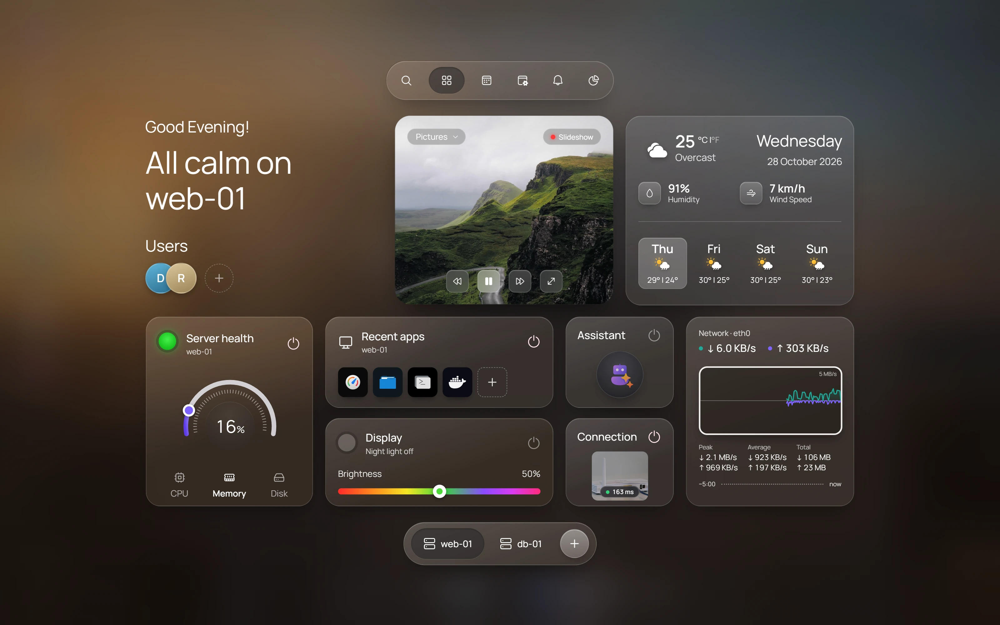

After you connect to a server, HeadlessOS shows it as a desktop. Every window belongs to that server. To work with several, see [Sessions and Fleet](/docs/guides/sessions-and-fleet).

## Open an app

Double-click a desktop icon, or use the dock, launcher or command palette. Right-click the desktop for more apps. Most apps have one window per server, and opening one again brings it forward.

Docker needs `docker` on the server, and Services needs `systemctl`. The other apps need nothing specific, though some [Server Admin](/docs/apps/server-admin) sections use their own tools.

## Move and arrange windows

- **Move:** drag the title bar.
- **Resize:** drag the bottom-right corner.
- **Maximize:** double-click the title bar, or drag it to the top edge.
- **Snap:** drag the title bar to a side for half the screen, or a corner for a quarter.

Right-click the title bar for **Minimize**, **Close** and **Move to session**.

:::note
A minimized app stops until you restore it. In [Terminal](/docs/apps/terminal), that means a new shell.
:::

## Use the dock

The dock holds **Launcher**, **Home hub**, **Search**, pinned apps, other open apps and **Recycle Bin**.

Click an app to open it or bring it forward. Click the front app to minimize it.

Right-click an app for **Pin to Dock** or **Unpin from Dock**, and **Close Window**. Right-click the dock for **Show Desktop**.

## Use the launcher

Click **Launcher** or press Ctrl+Space. Search apps, or use the quick actions, the app grid, **My Apps** (views you saved as apps) and **Recent**.

**Lock** covers the desktop with a clock and stays connected. It asks for no password: any key leads to Control Center. **Switch User** and **Sign Out** both disconnect the server and go to Control Center.

## Use Quick Settings

The menu bar runs along the top. Click its three status icons to open Quick Settings:

| Control | What it does |
|---|---|
| **Server** | Connects or disconnects the server |
| **Notifications** | Turns pop-up notifications on or off |
| **Dark** | Switches between dark and light |
| **Glass**, **Accent** | Change transparency and accent colour |
| **Desktop** | Minimizes all windows, or restores them |
| **Personalize** | Opens wallpaper settings |

**All settings** opens [Settings](/docs/guides/settings).

## Check notifications

Click the date and time. A dot means something is unread. The panel lists notifications above a calendar, with **Mark all read** and **Clear all**. It currently records File Explorer uploads. The list clears when you reload or quit the app.

## Use the Home hub

Click **Home hub** in the dock for a full-screen view of one server. Press Escape to close it. Pick another server in the bar at the bottom.

- **Server health:** a dial for CPU, Memory or Disk. The light turns amber at 75% and red at 90%.
- **Recent apps:** your last few apps.
- **Network traffic:** download above the line, upload below, with **Peak**, **Average** and **Total**. Click the time axis for the last 1, 5 or 15 minutes. It records only while the hub is open.
- **Weather:** set a city in Settings. Forecasts come from Open-Meteo, which receives the city, not your server data.
- **Display:** brightness and night light for HeadlessOS.

## Search with the command palette

Press Ctrl+K or click **Search**. Find apps, saved apps, theme actions and Settings pages.

## Keyboard shortcuts

| Keys | Action |
|---|---|
| Ctrl+Space | Launcher |
| Ctrl+K | Command palette |
| Ctrl+D | Show or restore the desktop |
| Alt+F4 | Close the window |
| Ctrl+Up, Ctrl+Down | Maximize; restore or minimize |
| Ctrl+Left, Ctrl+Right | Snap left or right |
| Ctrl+1 to Ctrl+9 | Switch session |
| Ctrl+Tab, Ctrl+Shift+Tab | Next or previous session |
| Ctrl+Shift+H | Hibernate this session |
| Ctrl+Shift+Space | Open Control Center |

On a Mac, Cmd also works unless macOS uses the key. Most shortcuts are ignored while you type in a field or the terminal. A browser may catch some first, such as Ctrl+Tab.
