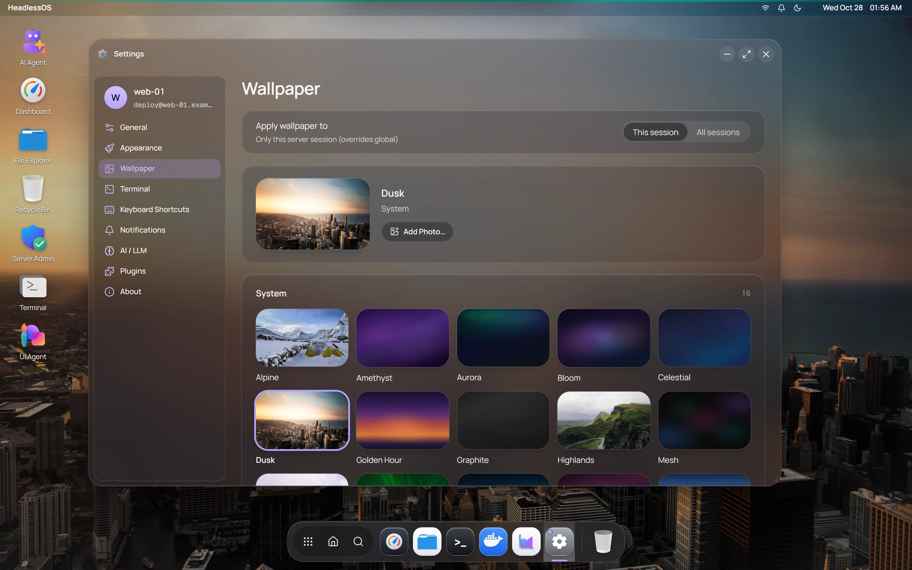

HeadlessOS has two places for settings. Most of what you need is in the Settings app.

| | **Global Settings** | **Settings app** |
|---|---|---|
| **Where** | [Control Center](/docs/guides/sessions-and-fleet), no server needed | On the desktop |
| **Open it with** | The **Global Settings** tab | Launcher, dock, or **All settings** in Quick Settings |
| **Holds** | Default accent colour, toast notifications, session import, log file | Everything else on this page |

A toast is a short pop-up message. **Default accent colour** and the toast options are the same settings in both places, so a change in one shows in the other.

Preferences are stored in the app on your computer, so a browser and the desktop app each keep their own. Saved servers, sessions and API keys are in `~/.headlessos/`.

## Set a different wallpaper for each session

Wallpaper is the one setting you can choose per session.

1. Open **Settings** and go to **Wallpaper**.
2. Under **Apply wallpaper to**, choose **This session** or **All sessions**.
3. Pick a wallpaper.

**This session** is selected by default and overrides the global choice. Click **Reset** to go back to it. If **Accent colour** is **Match wallpaper**, the accent follows the session's wallpaper too.

Everything else applies to all sessions, including the theme, clock, notifications and AI provider.

## The Settings pages

| Page | What you can change |
|---|---|
| **General** | **Clock Format**, **Auto-Refresh Interval**, **Auto-Hibernate Inactive Sessions**, **Privacy Screen**, and the city and units for **Weather** |
| **Appearance** | **Theme** (Light, Dark or Auto), **Accent colour**, **Glass strength**, **Transparency effects**, **Dock Position**, **Dock Icons**, **Desktop Icon Size** |
| **Wallpaper** | **Built-in** and **System** wallpapers, and your own with **Add Photo…**, up to 20 MB |
| **Terminal** | See [Terminal](/docs/apps/terminal) |
| **Keyboard Shortcuts** | A reference list. See [Using the desktop](/docs/guides/desktop) |
| **Notifications** | **Show Notifications**, **Position**, and **Data & Storage** |
| **AI / LLM** | Your provider, model and key. See [AI setup](/docs/ai/setup) |
| **About** | Version, and **Open log** in the desktop app |

## Auto-refresh and the Privacy Screen

**Auto-Refresh Interval** defaults to 30 seconds. It sets how often slower data updates in Dashboard, [Docker](/docs/apps/docker), [Services](/docs/apps/services) and Fleet. Choose **Off** to refresh by hand. Task Manager and the Dashboard's CPU and network figures update every 2 seconds whatever you choose.

**Privacy Screen** shows the Home hub over the desktop after a period with no input. Press any key to return. It hides the screen, but it isn't a lock.

## Reset or clear settings

Both are under **Notifications**, in **Data & Storage**:

- **Clear Cached Data** removes everything HeadlessOS keeps in browser storage, including your preferences. Saved servers and keys in `~/.headlessos/` stay.
- **Reset All Settings** restores default preferences and sets the theme to Dark.

## Open the log file

In the desktop app, open **Global Settings** and click **Open log** under **Log file**. This also works from **About** in the Settings app. The log stays on your computer. If something goes wrong, see [Troubleshooting](/docs/troubleshooting).
