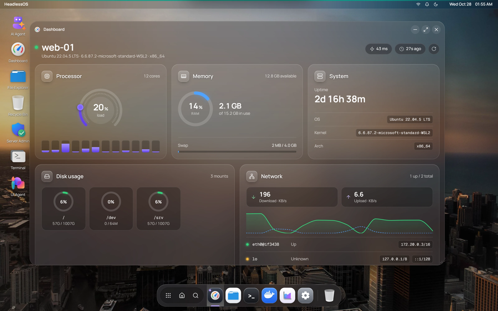

HeadlessOS is a free, open-source app that runs on your own computer. It connects to your Linux servers over SSH and shows each one as a desktop, with windows, a dock and apps. Nothing is installed on the server.

It's for people with a VPS, cloud servers or a home lab who know SSH and want a visual way to check on a server and manage it. A real terminal is always one click away.



## What you can do

| App | What it's for |
| --- | --- |
| [Dashboard](/docs/apps/dashboard) | See CPU, memory, disk and network at a glance |
| [File Explorer](/docs/apps/file-explorer) | Browse, edit and manage files on the server |
| [Terminal](/docs/apps/terminal) | Use an interactive SSH terminal |
| [Docker](/docs/apps/docker) | Manage containers and images |
| [Services](/docs/apps/services) | Manage systemd services |
| [Task Manager](/docs/apps/task-manager) | View and manage running processes |
| [Server Admin](/docs/apps/server-admin) | Handle network, firewall, security, packages, cron, logs and storage |

Each server is its own session, so you can keep several open and switch between them. See [Sessions and Fleet](/docs/guides/sessions-and-fleet).

## How it works

```text
Your computer                                    Your server
+----------------------------------------+       +---------------+
|  App window  <-->  Local backend       |  SSH  |  Just sshd,   |
|                    (127.0.0.1 only)    | ----> |  unchanged    |
+----------------------------------------+       +---------------+
```

The backend is the part of the app that holds your SSH connections. It runs on your computer and listens only on `127.0.0.1`, so other machines can't reach it.

1. You add a server with its address, username and a password or SSH key.
2. The backend connects over SSH.
3. It runs ordinary commands such as `df -h` and `docker ps`, and reads files over SFTP.
4. A built-in parser turns the text output into structured data. If no parser fits and you've chosen an AI provider, a model reads the output instead.
5. The app shows the result in its windows.

Read more in [Architecture](/docs/concepts/architecture) and [How parsing works](/docs/concepts/parsing).

## Why nothing runs on the server

Many server panels ask you to install an agent or a web service on every server. That's one more thing to update and secure on each machine, and it takes memory on a small VPS.

HeadlessOS uses the SSH access you already have. There is no agent, no daemon and no port to open. To your server, it looks like a normal SSH session.

Some apps can change the server when you ask them to, such as installing Docker or a package. The [FAQ](/docs/faq) lists these.

## AI is optional

With no AI provider chosen, HeadlessOS uses only its built-in parsers. The [AI Agent](/docs/ai/agent) and [UI Agent](/docs/ai/ui-agent) need a provider: OpenAI, Claude or a local model through Ollama. You choose one in **Settings → AI / LLM**.

Agents don't write shell commands. They pick typed actions from a fixed list, and anything that changes a server waits for your approval. See [Safety and approvals](/docs/ai/safety).

## Project status

This page covers version 0.2.1, which **Settings → About** labels Alpha. Expect rough edges, try it on a test server first, and [report what you find](https://github.com/abhee235/headlessos/issues).

## Next steps

- [Quick Start](/docs/getting-started): download the app and connect your first server.
- [Connect a server](/docs/connect-a-server): passwords, SSH keys and what a server needs.
- [Security model](/docs/concepts/security): what stays on your computer and what reaches the server.
- [GitHub repository](https://github.com/abhee235/headlessos): the source code, under the MIT licence.
